# NF1.UD4

## Taula de Continguts

[Fase 1. Preparació de l'entorn](#fase-1-preparació-de-lentorn)

[Fase 2: Preparació del servidor](#fase-2-preparació-del-servidor)

[Fase 3: L'Exportació d'Administració](#fase-3-lexportació-dadministració)

---

### Fase 1. Preparació de l'entorn

Hem de tenir una maquina clinet (Zorin os) i el servidor ubuntu els dos amb xarxa nat tambe conectem el servidor amb el adaptador nomes amfitrió.

Aqui hi ha les captures amb les configuracions del ubutnu servir i xorin

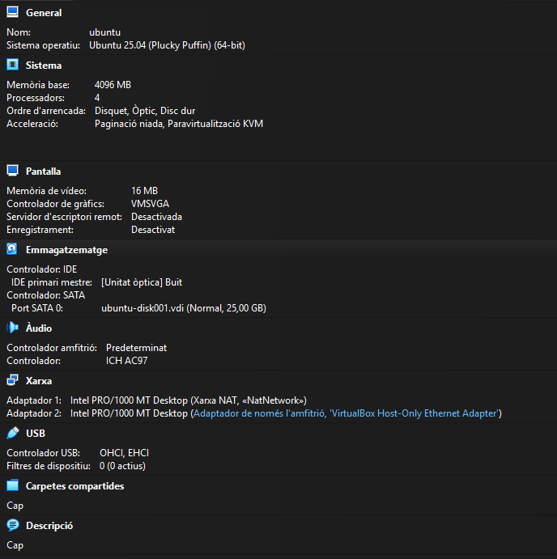

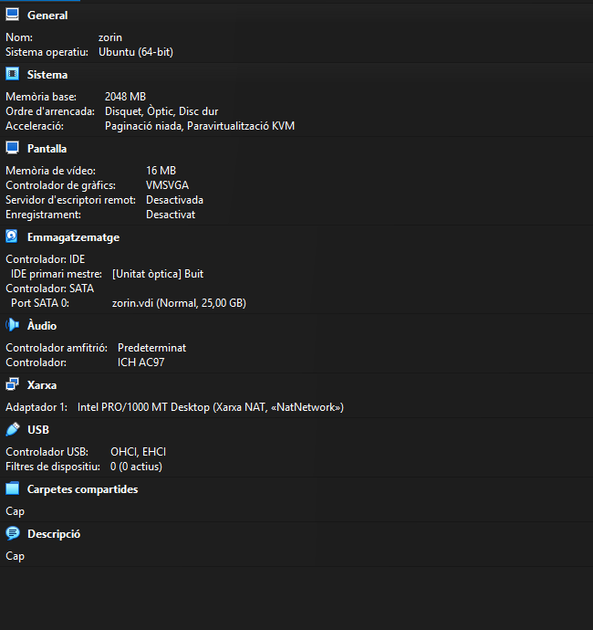

---

### Fase 2: Preparació del servidor


Primer crearem els grups devs i admins

```bash
sudo groupadd devs
sudo groupadd admins
```

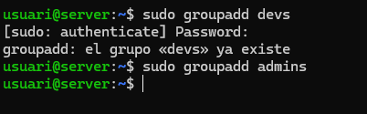

Ara crearem el usuari dev01 dintre del grup devs

```bash
sudo useradd -m -g devs dev01
```

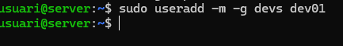

Ara el usuari admin01 dins del grup admins

```bash
sudo useradd -m -g admins admin01
```

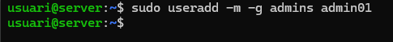

Ara crearem els directoris /srv/nfs/dev_projects i /srv/nfs/admin_tools

```bash
sudo mkdir -p /srv/nfs/dev_projects /srv/nfs/admin_tools
``` 

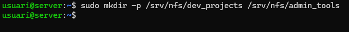

Ara hem de Configurar els permisos dels grups de devs i admins que els dos han de ser root i que els devs tinguin el control sobre els projectes (directori) i a els admins a les einie (directori).

Propietari root i grup devs per a projectes de desenvolupament:

```bash
sudo chown root:devs /srv/nfs/dev_projects
```

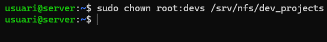

Propietari root i grup admins per a eines d'administració:

```bash
sudo chown root:admins /srv/nfs/admin_tools
```

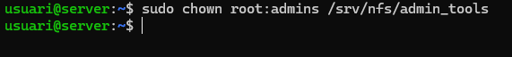

Ara utilitzarem la comanda chmod per configurar els permisios de cada prup i per els directoris per configurar el control total

De devs:

```bash
sudo chmod 770 /srv/nfs/dev_projects
```

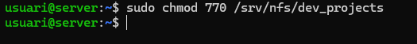

De Admins:

```bash
sudo chmod 770 /srv/nfs/admin_tools
```

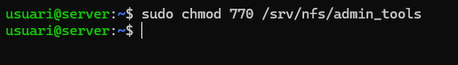

Ara instal·larem els paquets necesaris per el servei NFS

```bash
sudo apt update
sudo apt install nfs-kernel-server -y
```

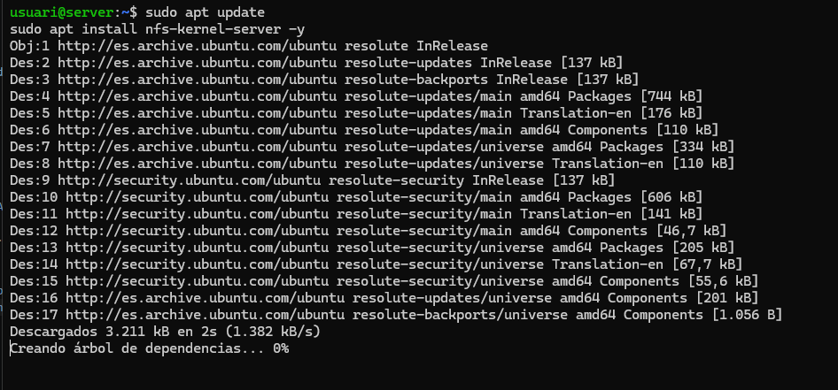

Ara la Configuracio de les exportacions que haurem d'editar l'arxiu /etc/exports

```bash
 sudo nano /etc/exports
```

I posem aixo al final de l'arxiu per configurar les exportacions (a la ip hem de posar el rang de ips de el adaptadors xarxa NAT)

```text
/srv/nfs/dev_projects  10.0.2.0/24(rw,sync,no_subtree_check,insecure)
/srv/nfs/admin_tools   10.0.2.0/24(rw,sync,no_subtree_check,insecure)
```

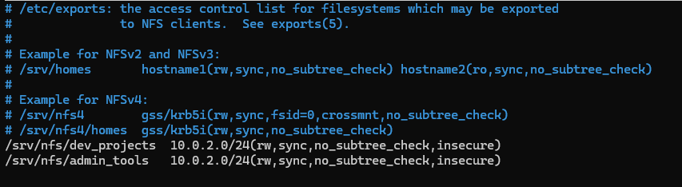

Ara farem les comprovacions per saber si estan ben configurades 

El primer es reiniciar el servei NSF

```bash
sudo systemctl restart nfs-kernel-server
```

I despres fem la comprovacio

```bash
sudo showmount -e
```

El resultat hauria de ser:

```text
Export list for localhost:
/srv/nfs/dev_projects 10.0.2.0/24
/srv/nfs/admin_tools  10.0.2.0/24
```

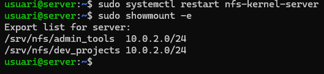

---

### Fase 3: L'Exportació d'Administració

#### Prova 1 l'error comu

El primer es editar l'arxiu /etc/exports per començar amb la exportacio 

```bash
sudo nano /etc/exports
```

Ara afegim aquesta linia a l'arxiu

```text
/srv/nfs/admin_tools *(rw,sync,no_subtree_check)
```

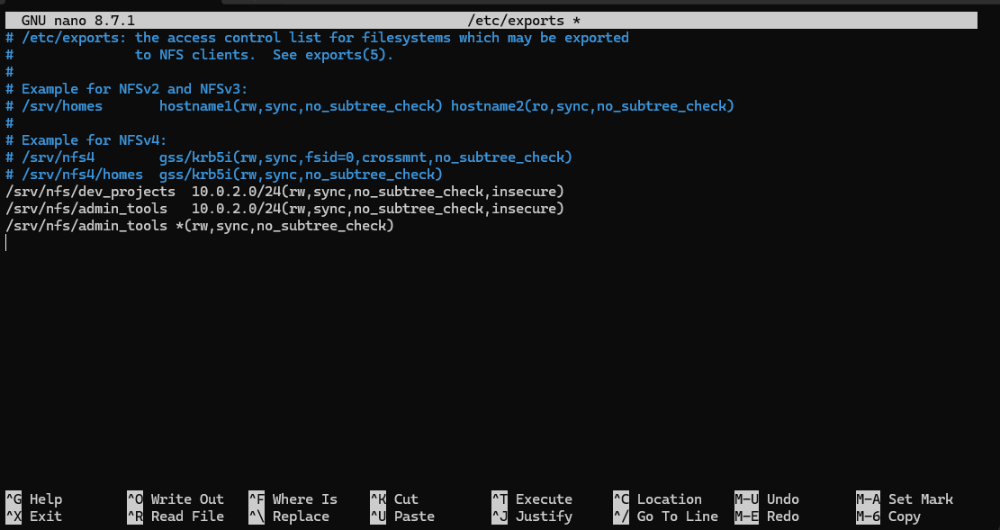

Ara hem de restaurar el server de nfs i de exportacions perque funcioni

```bash
sudo exportfs -a 
sudo systemctl restart nfs-kernel-server
```

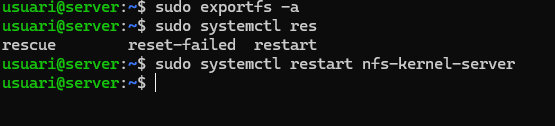

Ara proverem de fer l'exportacio al clinet (primer hem hagut d'instal·lar el sarve nfs-common a el clinet)

Primer crearem el punt de muntatge local

```bash
sudo mkdir -p /mnt/admin_tools
```

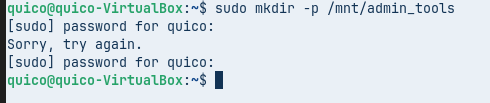

Ara muntem la carpeta compratida al servidor desde el client (10.0.2.7 es la ip de l'adaptador 'xarxa NAT' del servidor)

```bash
sudo mount -t nfs 10.0.2.7:/srv/nfs/admin_tools /mnt/admin_tools
```

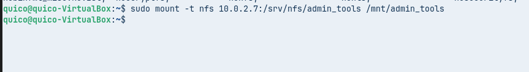

I ara hem de fer aixo 

```bash
sudo touch /mnt/admin_tools/prova1.txt
```

Pero el que passa es que no ens deixa i aquest es un dels errors mes comuns a l'hora de fer carpetes compartides amb NFS.

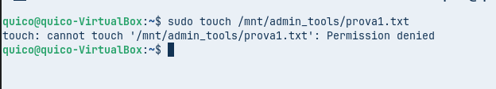


---

#### Prova 2 solucio

D'acord ara començem desde cero.

El Primer es anar a l'ubuntu server i hem de tornar a editar l'arxiu d'exportacions.

```bash
sudo nano /etc/exports
```

I canviem la linia

```text
/srv/nfs/admin_tools *(rw,sync,no_subtree_check)
```

Per

```text 
/srv/nfs/admin_tools *(rw,sync,no_subtree_check,no_root_squash)
```

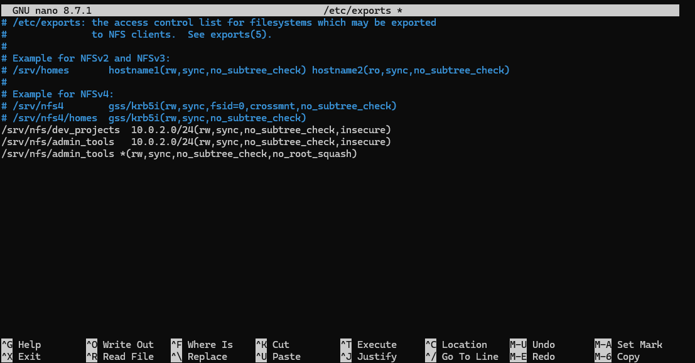

Ara re-exportem el recurs i actualiazem el servei

```bash
sudo exportfs -a 
sudo systemctl restart nfs-kernel-server
```

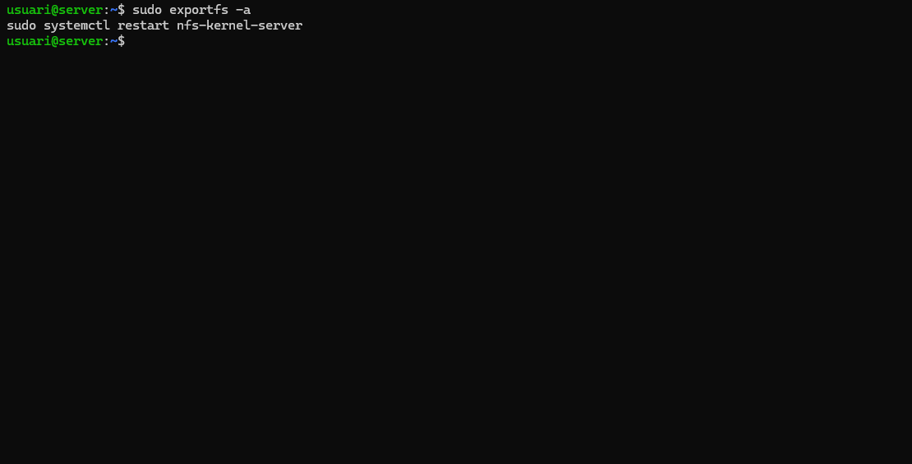

Ara pasarem a traballa a la maquina client (zorin)

Ara el primer es desmontar la carpeta de la prova 1 amb 

```bash
sudo umount /mnt/admin_tools
```

Ara Montarem la carpeta amb la comanda

```bash
sudo mount -t nfs IP_DEL_SERVIDOR:/srv/nfs/admin_tools /mnt/admin_tools
```

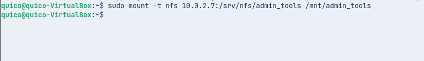


Ara toca crear el fitxer que li direm prova2.txt


